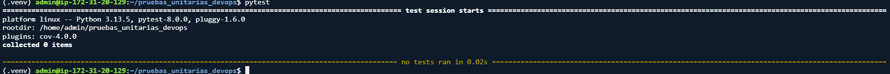
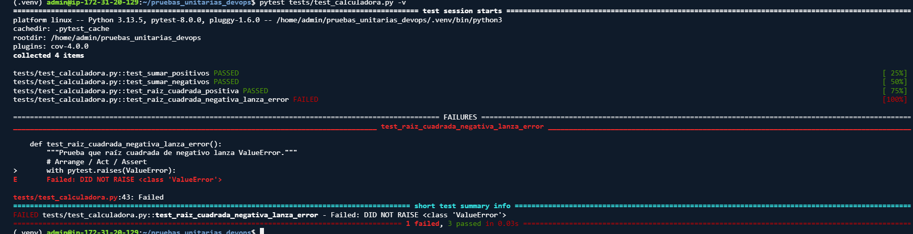
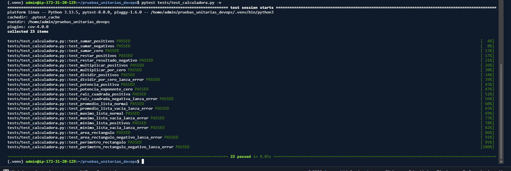
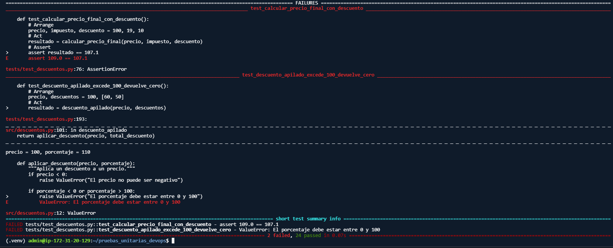
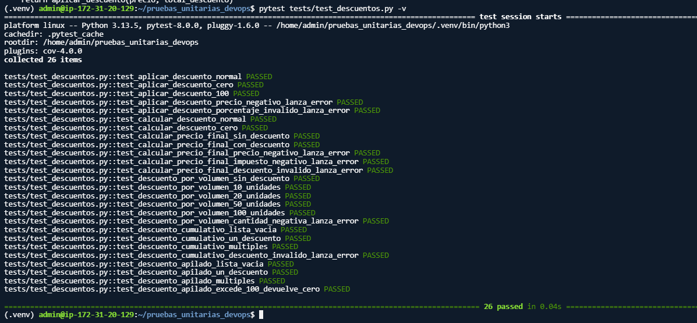
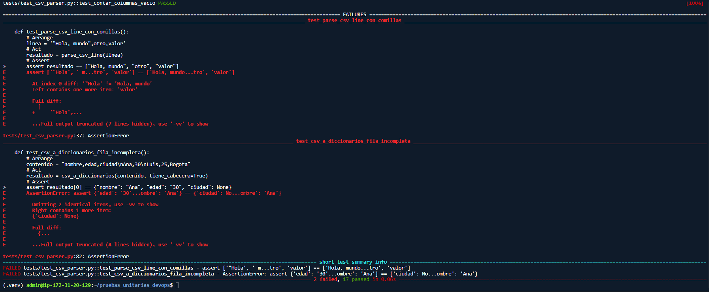
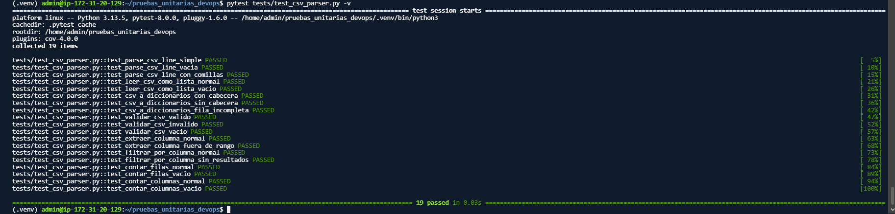

# Informe — Taller de Pruebas Unitarias

## Datos
- **Nombre:** Julián Mateo Rodríguez Díaz
- **Grupo:** 1
- **Fecha de entrega:** 17 de octubre de 2026
- **Curso:** Introducción a DevOps — Universidad Nacional de Colombia, Sede Manizales

---

## Análisis por módulo

### Módulo: calculadora

**¿Qué hace?**
Contiene funciones matemáticas básicas: suma, resta, multiplicación, división, potencia, raíz cuadrada, promedio, máximo, mínimo, área y perímetro de rectángulo.

**Casos probados y por qué:**
Se diseñaron 23 pruebas siguiendo la estructura AAA. Se eligieron tres tipos de casos:
1. **Casos normales:** números positivos, listas con múltiples elementos. Verifican el funcionamiento esperado en condiciones típicas.
2. **Casos límite:** cero, listas vacías, exponente cero, valores negativos. Buscan revelar comportamientos incorrectos en los extremos del dominio.
3. **Casos de error:** división por cero, raíz de negativo, listas vacías en promedio/máximo/mínimo. Verifican que el código lance excepciones controladas en lugar de fallar silenciosamente.

**Bugs encontrados:**

1. **`raiz_cuadrada` con números negativos**
   - La función no validaba la entrada. Al recibir un número negativo, Python devolvía un número complejo en lugar de lanzar una excepción.
   - **Corrección:** Se agregó una verificación `if numero < 0: raise ValueError(...)`.

2. **`minimo` con listas de positivos**
   - La variable `min_val` se inicializaba en `0`. Si la lista contenía solo números positivos, el mínimo devuelto era `0`, aunque no perteneciera a la lista.
   - **Corrección:** Se inicializó con el primer elemento de la lista: `min_val = lista[0]`.

**Evidencia:**
- 
- 
- 

---

### Módulo: descuentos

**¿Qué hace?**
Contiene funciones para calcular descuentos: aplicar un porcentaje, calcular el monto del descuento, calcular el precio final con impuesto, descuento por volumen, descuento acumulativo y descuento apilado.

**Casos probados y por qué:**
Se diseñaron 26 pruebas siguiendo la estructura AAA. Se probaron:
1. **Casos normales:** descuentos típicos (10%, 25%, etc.).
2. **Casos límite:** descuento del 0%, 100%, listas vacías, cantidades en los umbrales de volumen (10, 20, 50, 100 unidades).
3. **Casos de error:** precios negativos, porcentajes fuera de rango (>100), cantidades negativas.

El objetivo fue verificar no solo el cálculo correcto, sino también la consistencia en el orden de aplicación de impuestos y descuentos.

**Bugs encontrados:**

1. **`calcular_precio_final` aplica mal el impuesto**
   - El impuesto se calculaba sobre el **precio original**, no sobre el **precio con descuento**. Ejemplo: precio=100, descuento=10%, impuesto=19% → devolvía 109.0 en lugar de 107.1.
   - **Corrección:** `impuesto_monto = precio_con_descuento * (impuesto / 100)`.

2. **`descuento_apilado` no limita el descuento total al 100%**
   - Si los descuentos sumaban más de 100%, `aplicar_descuento` lanzaba `ValueError` en lugar de limitar el descuento a 100% y devolver 0.
   - **Corrección:** `total_descuento = min(sum(descuentos), 100)`.

**Evidencia:**
- 
- 

---

### Módulo: csv_parser

**¿Qué hace?**
Contiene funciones para parsear y manipular archivos CSV: parsear una línea, leer CSV como lista, convertir a diccionarios, validar formato, extraer columnas, filtrar filas y contar filas/columnas.

**Casos probados y por qué:**
Se diseñaron 18 pruebas siguiendo la estructura AAA. Se usó `StringIO` para simular archivos CSV sin leer del disco (**mocking**), tal como pide el taller en el puntaje extra.

Se probaron:
1. **Casos normales:** CSV con cabecera, sin cabecera, múltiples filas.
2. **Casos límite:** líneas vacías, columnas fuera de rango, filas con menos columnas que la cabecera.
3. **Casos de error:** contenido vacío, comillas anidadas.

**Bugs encontrados:**

1. **`parse_csv_line` no maneja comillas correctamente**
   - Cuando la línea tenía comillas (ej. `"Hola, mundo",otro`), el `split(',')` separaba incorrectamente. Devolvía `['"Hola', ' mundo"', 'otro']` en lugar de `['Hola, mundo', 'otro']`.
   - **Corrección:** Usar `csv.reader` de la librería estándar: `reader = csv.reader(StringIO(linea)); return next(reader)`.

2. **`csv_a_diccionarios` no maneja filas con diferente número de columnas**
   - Si una fila tenía menos columnas que la cabecera, las columnas faltantes se ignoraban silenciosamente. Debería rellenar con `None`.
   - **Corrección:** `fila_dict[cabecera] = fila[i] if i < len(fila) else None`.

**Evidencia:**
- 
- 

---

## Tabla de bugs encontrados

| Función | Entrada | Resultado erróneo | Resultado esperado | Corrección aplicada |
|---------|---------|-------------------|--------------------|---------------------|
| `raiz_cuadrada` | `-4` | Número complejo | Lanzar `ValueError` | Agregar verificación `if numero < 0` |
| `minimo` | `[5, 3, 8, 1, 9]` | `0` | `1` | Inicializar con `lista[0]` |
| `calcular_precio_final` | `precio=100, impuesto=19, descuento=10` | `109.0` | `107.1` | Aplicar impuesto sobre precio con descuento |
| `descuento_apilado` | `precio=100, descuentos=[60, 50]` | `ValueError` | `0` | Limitar con `min(sum(descuentos), 100)` |
| `parse_csv_line` | `'"Hola, mundo",otro'` | `['"Hola', ' mundo"', 'otro']` | `['Hola, mundo', 'otro']` | Usar `csv.reader` |
| `csv_a_diccionarios` | `"nombre,edad,ciudad\nAna,30"` | `{"nombre": "Ana", "edad": "30"}` | `{"nombre": "Ana", "edad": "30", "ciudad": None}` | Rellenar con `None` |

---

## Cobertura

*Pendiente: se agregará al final del taller.*

---

## Reflexión final

*Pendiente: se agregará al final del taller.*
