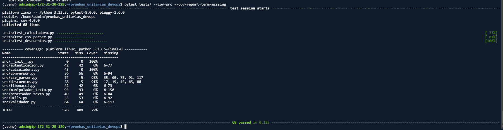

# Universidad Nacional de Colombia

### Sede Manizales — Facultad de Ingeniería y Arquitectura

---

# Taller — Análisis y Mejora de Pruebas Unitarias

**Curso:** Introducción a DevOps

**Docente:** César Augusto Palacios Alarcón

---

**Estudiante:** Julián Mateo Rodríguez Díaz

**Grupo:** 1

**Fecha de entrega:** 17 de octubre de 2026

---

## Tabla de contenido

1. [Introducción](#introducción)
2. [Análisis por módulo](#análisis-por-módulo)
   - [Calculadora](#módulo-calculadora)
   - [Descuentos](#módulo-descuentos)
   - [CSV Parser](#módulo-csv_parser)
3. [Tabla de bugs encontrados](#tabla-de-bugs-encontrados)
4. [Cobertura](#cobertura)
5. [Reflexión final](#reflexión-final)

---

## Introducción

Este informe presenta el trabajo realizado en el taller de pruebas unitarias del curso Introducción a DevOps. El objetivo fue escribir pruebas con estructura AAA (Arrange, Act, Assert) para al menos tres módulos del proyecto, encontrar bugs ocultos en el código, corregirlos, medir la cobertura de las pruebas y documentar todo el proceso.

El trabajo se realizó sobre un fork del repositorio `cesarpalacios/pruebas_unitarias_devops`, siguiendo el flujo típico de DevOps: escribir pruebas, ejecutarlas, corregir errores y dejar evidencia en el repositorio.

---

## Análisis por módulo

### Módulo: calculadora

**¿Qué hace?**
Es un módulo con operaciones matemáticas básicas: suma, resta, multiplicación, división, potencia, raíz cuadrada, promedio, máximo, mínimo, área y perímetro de un rectángulo.

**Casos que probé y por qué:**
Escribí 23 pruebas siguiendo la estructura AAA. Me enfoqué en tres tipos de casos:

1. **Casos normales:** por ejemplo, sumar dos positivos, restar dos números, multiplicar, etc. Son los casos que uno espera que funcionen sin problema.
2. **Casos límite:** cosas como cero, listas vacías, exponente cero, valores negativos. Estos son los que suelen romper el código porque no siempre se piensan al programar.
3. **Casos de error:** división por cero, raíz de un negativo, listas vacías en promedio/máximo/mínimo. Aquí lo que busco es que el código no falle en silencio, sino que lance un error controlado.

**Bugs que encontré:**

1. **`raiz_cuadrada` con números negativos**
   - La función no revisaba si el número era negativo. En Python, `(-4) ** 0.5` no lanza error, sino que devuelve un número complejo. Eso no tiene sentido para una calculadora básica.
   - **Solución:** Agregué `if numero < 0: raise ValueError(...)`.

2. **`minimo` con listas de positivos**
   - La variable `min_val` empezaba en `0`. Si la lista tenía solo números positivos, el mínimo devuelto era `0`, aunque no estuviera en la lista. Por ejemplo, para `[5, 3, 8, 1, 9]` devolvía `0` en lugar de `1`.
   - **Solución:** Inicializar con el primer elemento: `min_val = lista[0]`.

**Evidencia:**
- 
- 
- 

---

### Módulo: descuentos

**¿Qué hace?**
Tiene funciones para calcular descuentos: aplicar un porcentaje, calcular el monto del descuento, calcular el precio final con impuesto, descuento por volumen, descuento acumulativo y descuento apilado.

**Casos que probé y por qué:**
Escribí 26 pruebas con estructura AAA. Probé:

1. **Casos normales:** descuentos típicos (10%, 25%, etc.).
2. **Casos límite:** descuento del 0%, 100%, listas vacías, cantidades justo en los umbrales de volumen (10, 20, 50 y 100 unidades).
3. **Casos de error:** precios negativos, porcentajes fuera de rango (más de 100), cantidades negativas.

Lo que más me interesaba aquí era verificar el orden de aplicación de impuestos y descuentos, porque un error ahí cambia el resultado final.

**Bugs que encontré:**

1. **`calcular_precio_final` aplica mal el impuesto**
   - El impuesto se calculaba sobre el precio original, no sobre el precio con descuento. Por ejemplo: precio=100, descuento=10%, impuesto=19% → devolvía 109.0 en lugar de 107.1.
   - **Solución:** `impuesto_monto = precio_con_descuento * (impuesto / 100)`.

2. **`descuento_apilado` no limita el descuento total al 100%**
   - Si los descuentos sumaban más de 100%, `aplicar_descuento` lanzaba un `ValueError` en lugar de limitar el descuento a 100% y devolver 0.
   - **Solución:** `total_descuento = min(sum(descuentos), 100)`.

**Evidencia:**
- 
- 

---

### Módulo: csv_parser

**¿Qué hace?**
Es un módulo para parsear y manipular archivos CSV: parsear una línea, leer CSV como lista, convertir a diccionarios, validar formato, extraer columnas, filtrar filas y contar filas/columnas.

**Casos que probé y por qué:**
Escribí 18 pruebas con estructura AAA. Usé `StringIO` para simular el contenido de archivos CSV sin leer archivos reales del disco. Eso es lo que el taller llama **mocking**, y me sirvió para que las pruebas no dependieran de archivos externos.

Probé:

1. **Casos normales:** CSV con cabecera, sin cabecera, con varias filas.
2. **Casos límite:** líneas vacías, columnas fuera de rango, filas con menos columnas que la cabecera.
3. **Casos de error:** contenido vacío, comillas anidadas.

**Bugs que encontré:**

1. **`parse_csv_line` no maneja bien las comillas**
   - Si la línea tenía algo como `"Hola, mundo",otro`, el `split(',')` separaba mal: devolvía `['"Hola', ' mundo"', 'otro']` en lugar de `['Hola, mundo', 'otro']`.
   - **Solución:** Usar `csv.reader` de la librería estándar: `reader = csv.reader(StringIO(linea)); return next(reader)`.

2. **`csv_a_diccionarios` no maneja filas con diferente número de columnas**
   - Si una fila tenía menos columnas que la cabecera, las columnas que faltaban se ignoraban sin avisar. Debería rellenarse con `None` para que el diccionario quede consistente.
   - **Solución:** `fila_dict[cabecera] = fila[i] if i < len(fila) else None`.

**Evidencia:**
- 
- 

---

## Tabla de bugs encontrados

| Función | Entrada | Resultado erróneo | Resultado esperado | Corrección aplicada |
|---------|---------|-------------------|--------------------|---------------------|
| `raiz_cuadrada` | `-4` | Número complejo | Lanzar `ValueError` | Agregar verificación `if numero < 0` |
| `minimo` | `[5, 3, 8, 1, 9]` | `0` | `1` | Inicializar con `lista[0]` |
| `calcular_precio_final` | `precio=100, impuesto=19, descuento=10` | `109.0` | `107.1` | Aplicar impuesto sobre precio con descuento |
| `descuento_apilado` | `precio=100, descuentos=[60, 50]` | `ValueError` | `0` | Limitar con `min(sum(descuentos), 100)` |
| `parse_csv_line` | `'"Hola, mundo",otro'` | `['"Hola', ' mundo"', 'otro']` | `['Hola, mundo', 'otro']` | Usar `csv.reader` |
| `csv_a_diccionarios` | `"nombre,edad,ciudad\nAna,30"` | `{"nombre": "Ana", "edad": "30"}` | `{"nombre": "Ana", "edad": "30", "ciudad": None}` | Rellenar con `None` |

---

## Cobertura

Ejecuté el reporte de cobertura con:
pytest tests/ --cov=src --cov-report=term-missing

El resultado fue:

| Módulo | Cobertura |
|--------|-----------|
| `calculadora.py` | 100% |
| `csv_parser.py` | 93% |
| `descuentos.py` | 91% |

Los tres módulos que trabajé superan el 85% que pide el taller. El total del proyecto es 29% porque hay otros módulos que no probé (el taller solo pedía trabajar al menos 3 módulos).

**Lectura de los resultados:**
- `calculadora.py` tiene 100% porque probé todas sus funciones, incluyendo los casos de error.
- `csv_parser.py` quedó en 93% y `descuentos.py` en 91% porque faltan algunas líneas relacionadas con validaciones que no llegué a cubrir (por ejemplo, algunas ramas de error). De todas formas, están por encima del mínimo pedido.
- El total de 29% no me preocupa porque el taller solo pide cobertura en los módulos que uno trabaja, no en todo el proyecto.

---

## Reflexión final

**¿Qué NO mide la cobertura?**
La cobertura mide qué porcentaje del código se ejecutó durante las pruebas, pero no dice si esas pruebas son buenas. Por ejemplo, puedo tener 100% de cobertura con pruebas que no verifican nada útil (que solo llaman a las funciones sin comprobar los resultados). Tampoco mide si el código hace lo que debería hacer, ni si los casos límite están bien cubiertos. La cobertura es una guía, no una garantía de calidad.

**¿Qué aprendí?**
Aprendí que escribir pruebas unitarias es una forma muy útil de encontrar bugs que uno no ve a simple vista. Muchas veces, al escribir la prueba, uno se da cuenta de que el código no hace lo que uno creía. También aprendí a usar la estructura AAA para organizar las pruebas, y a usar `mocking` con `StringIO` para no depender de archivos reales.

Por último, entendí que el flujo de DevOps no se trata solo de escribir código, sino de probarlo, medirlo y documentarlo. Este taller me hizo ver que las pruebas son parte del trabajo, no algo aparte.

---

**Fin del informe**

